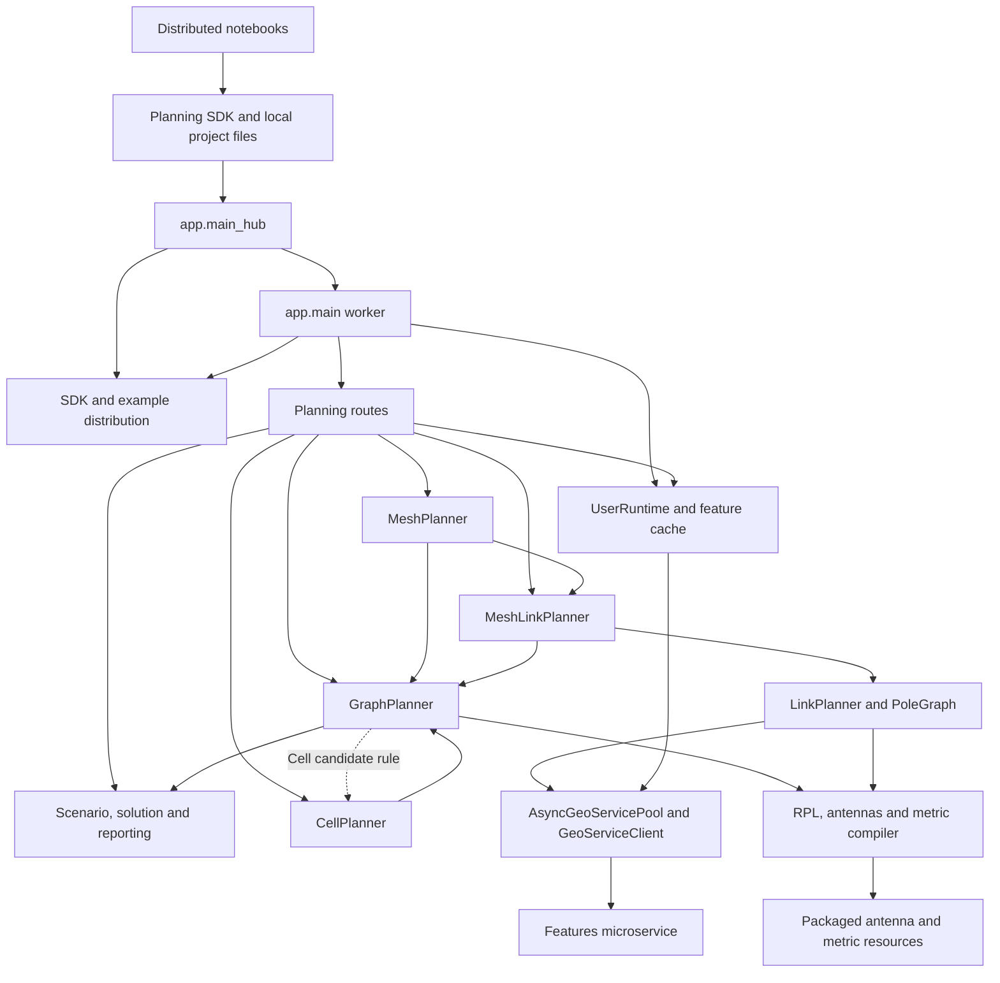

# Network service module inventory and reorganization test plan

Scope is the current working tree. Usage is based on source, route, deployment, test, and notebook references. It does not establish whether another repository imports this library. Proposed paths describe ownership and can be refined before files move.

## Current priority: operation artifact delivery and reopening (2026-11-19)

See the [artifact-delivery audit](sdk-v2-artifact-delivery-audit.md). This gate
supersedes earlier suggestions of permanent server retention or a reverse sync.
Each operation must return its artifacts and SDK v2 must save them before reporting
completion. Explicit close does no downloads and should ultimately delete server
storage; timeout/disconnection must preserve it. Current implementation is not
ready for that deletion policy.

- [ ] A1: Define operation-scoped artifact delivery metadata and one project-bound
  SDK IO receiver, durable local completion and failed/lost-response recovery.
  Preserve atomic local file writing; do not duplicate artifact logic per planner.
- [ ] A2: Make build return/save the actual compiled artifact and its report/identity.
- [ ] A3: Attach incremental raw feature artifacts to feature-producing operation/
  batch responses, persist locally before cursor advancement, and support server
  restoration. Include defined partial-failure checkpoints; no close-time fetch.
- [ ] A4: Define durable ongoing stage checkpoints or explicit replay boundaries
  for candidate parameters, partial metrics, effective Cell edits/pruned interfaces
  and Mesh preparation/round state. Final result/placements alone are insufficient.
- [ ] A5: Return/save the full solved result through solve itself. Current explicit
  save_result/save_placements helpers are useful but do not make preceding calls
  automatically durable.
- [ ] A6: Implement validated server restoration of locally saved generated
  artifacts/checkpoints, including old/new project identity handling. Input sync
  deliberately rejects compiled/result uploads and is not the restoration path.
- [ ] A7: Only after delivery/reopening gates pass, implement explicit close deletion
  and local recovery-metadata transition. Do not delete on timeout/disconnection.
- [ ] Revise the project lifecycle contract's obsolete close-retention wording as
  these changes land; current code still retains files and discards volatile cache.

Audit evidence: source/call-path review and a disposable Python-container API/SDK
probe with deterministic features. Build/tune/metrics/solve left only source files
and .session.json locally. Server cache had one raw feature record before close
and none afterward; compiled/result files remained server-only. Attempting to
restore a locally copied compiled artifact through fresh-project input sync was
rejected (422). No API/SDK implementation, notebook or deployment was changed by
the audit; the previous full regression suite was not rerun for documentation.

## Runtime dependency map

The production and development Dockerfiles start the hub. The hub spawns the worker and proxies planning requests. Both expose SDK and example distribution. The worker owns the planning runtime. In the current code, the cell planner uses the graph planner, and the graph planner lazily imports the cell planner for a cell candidate rule. Preserve that behavior during moves and decide how to remove the cycle in a separate change. Mesh link search is also an independently routed operation and is used from graph sessions by the SDK link-replanning workflow.

Sources: [Dockerfile](../../../infra/Dockerfile), [hub](../../../app/main_hub.py), [worker](../../../app/main.py), [planning routes](../../../app/routes_planning.py), [runtime](../../../app/session.py), [feature cache](../../../app/feature_cache.py), [graph candidate dispatch](../../../cisei_lib/planners/graph/graph_planner.py#L304), [SDK link replanning](../../../client_sdk/src/cisei_planning_sdk/link_replanning.py#L188).

## Module inventory and proposed homes

| Current modules | Evidence and role | Proposed home |
| --- | --- | --- |
| `app/main.py`, `main_hub.py`, `session.py`, `feature_cache.py` | Service entry points, worker lifecycle, runtime state and features integration | Keep in app. Keep session state and pool ownership at the application boundary. |
| `app/routes_planning.py`, `routes_examples.py`, `routes_sdk.py`, `version.py` | Planning HTTP contracts, distribution and version reporting | Keep in app. Extract workflow orchestration as needed into `app/workflows/`, with HTTP models and response adaptation in routes. |
| `planners/__init__.py` | Re-exports planner and model classes used by routes and tests | Preserve verified import paths during the transition. |
| `planners/graph_planner.py`, `geo_rpl_agnostic.py` | Graph candidate rules, edge metrics and RPL solving. Graph engine is shared by cell and mesh. | `planners/graph/`. Keep RPL with its current engine unless another active consumer needs an independent solver. |
| `planners/cell_planner.py`, `cell_planning_solution.py` | Primary-technology candidate generation and cell-specific result behavior | `planners/cell/` |
| `planners/mesh_planner.py`, `mesh_link_planner.py`, `link_planner.py`, `pole_graph_async.py` | Network expansion, point-to-point mesh studies, active pole-graph and path-search chain | `planners/mesh/`, with link search distinct from network expansion inside the package |
| `planners/planning_scenario.py`, `planning_solution.py`, `planner_classes.py` | Shared input, result and domain types. The class module also contains planner-specific types. | `planners/shared/` initially. Split planner-specific types only after checking their callers. |
| `planners/antenna_planner.py`, `metric_compiler.py`, `planner_reports.py` | Shared antenna models, metric compilation and result evaluation/report payloads | Shared planning modules. Keep HTTP response envelopes in app. |
| `io/async_geo_service_pool.py`, `geo_service_client.py` | Active remote features integration used by runtime and pole graph | Keep in IO initially. Audit transport ownership before moving. |
| `resources/antennas/`, `resources/metrics/` | Loaded by package resource APIs, including during mesh link search | Keep resource paths stable and verify installed artifacts. Audit individual resource references separately. |
| `usermng/homeFolder.py`, `planners/serializer.py`, `tools/safe_code.py` | Conditional persistence chain for LinkPlanner. The home helper is imported by the active module even though MeshLinkPlanner passes persist=False. Serializer loads when persistence is enabled. | Preserve during moves. Review standalone persistent callers before decoupling or removing. |
| `planners/bhPlan.py`, `mesh_bh_planner.py`, `planners/legacy/*` | Older backhaul and worker implementations outside the observed planning route chain. Some imports point at obsolete module paths. | Legacy retirement candidates pending consumer review. |
| `io/geo_service_pool.py`, `geo_notebook.py`, `geo_notebook_bak.py`, `example_usage.py` | Alternate pool and notebook/example interfaces outside the observed service chain | Check standalone consumers. Keep separate from the async service transport. |
| `core/rf/*`, `core/profiles/*`, `core/plot/*`, `dem/*`, `io/minio_access.py`, `resources/rssi_models/`, `resources/coverage/` | Local RF, terrain, plotting and storage stack. No current planning runtime path was identified. RFEngine loads packaged RSSI models. Coverage resources need a separate consumer check. | Verify whether features-service or standalone consumers use this code and data before extracting or retiring it. |
| `importer/*`, `monitoring/*`, `usermng/{routes,models,home_folder,configTools}.py`, `tools/{geo_tools,debug_utils}.py` | Dataset import, monitoring, older user-management and utilities outside the observed planning runtime chain | Audit related entry points and external callers as groups before deciding retention. |

The most useful removal distinction is between **outside the observed service path** and **safe to remove**. Treat the latter as a decision backed by deployment and consumer checks. Check dynamic imports and resources, then get confirmation of external use from maintainers where the repository cannot establish it.

### SDK migration destinations after the moves

- Installed topology, path diagnosis, dependency analysis and reconfiguration impact belong in a cross-planner domain package such as `cisei_lib/installed_network/`.
- Link replanning and project-extension coordination belong in `app/workflows/` when they combine multiple domain operations. Reusable graph decisions live with their domain code.
- Scenario instantiation and interpretation belong beside the shared scenario model. The SDK continues to resolve and read user files and write returned artifacts.

### Result artifacts and viewers

The planning API and saved result artifacts expose structured planning data. Built-in notebook viewers stay in the SDK distribution under a proposed `cisei_planning_sdk.ui` subpackage. Existing `show_*` methods delegate to those viewers. A saved result can be rendered locally, and live panels use public SDK methods for service operations.

`result.json` and its companion artifacts are the inputs for built-in and custom viewers, including AI-generated viewers. Document and version their fields, units, identifiers, and references. Test artifact compatibility across graph, cell, and mesh. Keep presentation choices in the viewer. When a renderer computes a planning fact that other consumers also need, move that computation to the service and expose the fact as structured data.

### Project input files by planning operation

Document the input requirements for the operation being run. A session opened
with the default graph planner can also run a mesh link study, so the planner
argument to `open_project()` alone cannot determine which files to load.

| Operation | Scenario and site inputs | Additional inputs |
| --- | --- | --- |
| Graph network planning | `scenario.toml` with embedded sites or a CSV referenced by `[instances].source`, commonly `nodes.csv` | The scenario provides candidate edges or rules. No pole file is required. |
| Cell network planning | Same scenario bundle, with the sites and interfaces for the selected primary technology | No pole file is required. |
| Mesh link study | Same scenario bundle, with the two endpoint interfaces selected in `plan_mesh_link()` | For a separate repeater inventory, use the CSV referenced by `[mesh.poles].source`, commonly `poles.csv`, or pass pole records through `poles=`. A direct-only study can run with no eligible repeater candidates. The link engine can also consider eligible candidate sites already defined in the scenario. |
| Mesh network expansion | Same scenario bundle, with fixed roots and sites to connect | Supply potential repeater infrastructure separately through `[mesh.poles].source` or `poles=`. The engine accepts an empty pole inventory and rejects optional infrastructure embedded among the network sites. |

#### Scenario TOML sections

| Section | When it is used |
| --- | --- |
| `[scenario]` | Scenario settings, including `working_crs` for projected coordinates. |
| `[antennas.*]`, `[interfaces.*]`, `[devices.*]` | Equipment definitions. A CSV-backed site references a device profile, which lists the interface profiles used to instantiate the site. |
| `[instances]` or `[[sites]]` | CSV-backed or embedded site definitions. The SDK reads `[instances].source` when sites are not embedded. CSV is the supported format, and `profile_column` defaults to `device_profile`. |
| `[net]` | Connectivity rules and explicit candidate edges. Installed topology workflows use the explicit edges to represent the installed links. |
| `[metrics.<tech>]` | Metric configuration by technology. |
| `[overrides.interfaces."<interface_id>"]` | Optional per-interface `enabled` override. It references a concrete interface after site expansion. |
| `[antenna_placements]` | Optional `source` for per-installation antenna settings. The SDK also discovers an adjacent `antenna_placements.toml` when the section is absent. |
| `[mesh]`, `[mesh.network]`, `[mesh.poles]` | Optional mesh search settings, network-specific controls, and a reference to the separate pole inventory. Mesh operations load these when called. |
| `[attachments]` | Optional attached-equipment inventory. Requires `source` when declared and accepts CSV format. Installed-network workflows load it separately from the RF scenario. |

#### CSV columns

| File | Identifiers and references | Coordinates and other fields |
| --- | --- | --- |
| Node CSV, commonly `nodes.csv` | `device_profile` must resolve to a device profile, unless `profile_column` selects another column. The SDK accepts `site_id`, `position_id`, `id`, or `name` for the site ID and generates one when all are absent. The SDK derives `<site>:d0` and `<site>:d0:i<n>` IDs from that site and the device profile. | Use `lat`/`lon` or `x`/`y` with the scenario CRS. Optional fields include `kind`, `connected`, `can_route`, `rank`, `candidate`, and `mount_height_m` (aliases `ant_h` and `antenna_height_m`). Other nonblank columns become site attributes. |
| Pole CSV, commonly `poles.csv` | `pole_id` and a device-profile reference. Pole IDs must be unique and distinct from network site IDs. | Coordinates and optional mounting height. The SDK assigns candidate and connectivity state for poles and rejects columns `site_id`, `connected`, `candidate`, and `rank`. |
| Attached equipment CSV, commonly `attached_equipment.csv` | Requires nonempty `equipment_id`, `equipment_type`, and `device_id`. The pair of equipment type and ID must be unique. `device_id` must match a concrete scenario device. | Extra descriptive columns are preserved. The inventory informs installed-network inspection and reconfiguration. An absent inventory row does not establish that the device can be removed. |

`features.json` is a reusable cache and `result.json` is a planning output.
Workflows that start from an existing solution have their own artifact
prerequisites. For example, link replanning reads the source scenario and
result, a confirmed reconfiguration selection, and a pole inventory for the
new search.

Include these requirements in the API and SDK review. Check embedded and
CSV-backed sites, profile resolution, concrete interface and device references,
installation overrides, missing referenced files, and attachment handling.
Include both inline poles and mesh studies without repeater candidates. The
SDK reads local files and transmits structured inputs. Before moving scenario
expansion, compare the SDK CSV loader and `PlanningScenario.from_toml()` on the
same bundles. Both currently implement instance loading.

#### Published mesh-link bundle contract

The hub and worker serve `GET /planning/project-schemas` and
`GET /planning/project-schemas/v1/mesh-link`. The latter returns a JSON Schema
Draft 2020-12 document, CSV file instructions, and a minimal parsed example.
The worker accepts that example at
`POST /planning/project-schemas/v1/mesh-link/validate`. Through the hub, prefix
the validation path with the registered user ID and send the existing
`X-Token` header.

Validation accepts parsed scenario TOML, tables keyed by project-relative
filename, and mesh-link arguments. Include each CSV header and its rows as
strings or nulls. The response gives a validity flag and issues with file,
CSV row, column, or JSON path when available. It checks the bundle before any
planning scenario is created and uses no features service. Version v1 covers
mesh link only. Per-installation antenna placement files are outside its
validation scope.

## Regression gates

### Antenna and sector tuning follow-up

- [x] Use concrete per-interface placements for both Cell filtering and Graph directional RF gain. Nonzero rotation, mixed fixed/automatic profiles and subsequent candidate rebuilding are covered by placement output regressions.
- [x] Define/export effective LTE orientations through the placement contract and save_placements. Separate outputs use original profile IDs and can be explicitly promoted to input. Rotation history is reporting/reset metadata, not hidden RF orientation.
- [ ] Complete field-level placement precedence verification. Device-profile → CSV row → concrete interface → placement mounting-height precedence is documented and tested, including blank/zero values and unaffected radios. Remaining coverage includes orientation/shadow sources and device/site metadata versus explicit installation fields. Normal compiled loading does not reapply placements. Library gain patterns remain distinct from installation angles.
- [x] Define the normal placement lifecycle: build from source files, apply placements during compilation, then load saved compiled settings unchanged. Source edits require recompilation and reloading; compiled loading never reapplies placements.
- [ ] Review legacy reimport of expanded TOML beside placement files during SDK compatibility cleanup. Current partial reapplication can reset omitted orientation/shadow fields to the base profile. This case does not block the normal lifecycle.
- [ ] Complete automatic omni mounting-shadow tuning and directional antenna orientation tuning. These methods were never completed; this is unfinished functionality, not just unverified integration. Both must obey the effective selected antenna profile's auto_tune policy (including placement-selected profiles), start from effective placements, leave fixed profiles unchanged, and apply/report/export accepted adjustments through the placement contract. Add regressions for policy, RF use, export and explicit reuse as inputs to the next project. Current implemented automatic support remains Cell sector azimuth tuning only. Confirmed with the user on 2026-11-19.
Placement processing is supported by the staged scenario builder, while SDK open_project() still invokes the local loader. Track the transition under the consolidated SDK migration checklist below; current module documentation identifies both callers.
- [x] Correct placement wrapper mutation documentation: lookup occurs before declaration removal, parsing/application after removal. Installation updates are validated before committing, but the declaration can already be removed on failure.
- [ ] Decide whether placement-wrapper failure should preserve the entire supplied configuration, including its declaration.

### Changes recorded during the contract review

- Added structured `ProjectIssue` records and `ProjectValidationError.to_dict()` to staged bundle building. Missing files, TOML parse locations, pole rows, and attachment device references carry diagnostics. Pole and attachment checks can report independent failures together. Existing ValueError handlers still catch expected validation failures.

- Added a combined staged-project regression covering nodes, placements, poles, and attached equipment. Failure cases corrupt one input at a time, assert the diagnostic identifies it, verify the previous bundle survives, and rebuild after restoring the file. Current feedback is a ValueError message; structured issues and HTTP responses remain pending.

- Staged bundle construction validates attached-equipment inventories and retains their file reference separately from the network. Both `[files].attached_equipment` and the legacy declaration are supported. Invalid device references identify the CSV row and preserve the previous bundle.

- Documented placement processing at module and function level, including expected input dictionaries, return values, in-place interface updates, and generated antenna profiles.

- Moved placement implementation out of `placements/__init__.py` into `placements/installation.py`. The initializer now contains public imports only. The SDK wheel packages the same module through its existing directory mapping.

- Grouped active bundle handling and antenna placements under `cisei_lib.project_io`, preserving its public build/read/load imports. Documented bundle structure, external inventory references, and current memory use beside the implementation. Moved prototype schema resources into `cisei_lib.legacy.project_schemas` and updated their HTTP compatibility routes and package-data paths. The SDK wheel continues to package the shared placement source.

- Feature-cache saves now use a cursor scoped to one server cache generation. A cache hit skips the full download and local rewrite. Appended entries transfer as a delta and the SDK advances the cursor after an atomic local save. Cache replacement and explicit exports use the full format.

- The staged bundle builder accepts `[files].poles` and `[mesh.poles].source`. It validates pole rows individually and keeps the staged CSV separate from the expanded network. The saved bundle retains the project-relative inventory reference and Mesh controls. A future Mesh execution step can query or filter the inventory before expanding the selected candidates.

- The staged bundle builder now applies per-interface antenna placements before saving. It recognizes `[files].antenna_placements`, the legacy source declaration, and the existing adjacent-file convention. The service and the SDK wheel use one authored placement implementation. LTE, omni shadow, and directional tuning remain planning operations.

- Added server-local `cisei_lib.project_io.build_project_bundle()` and `load_project_bundle()`. The first round trip covers scenario and node inputs, including legacy `[instances].source` and the proposed `[files].nodes` form. Successful builds save expanded JSON on disk. A failed build leaves any existing bundle intact. Mesh, attachments, placements, and HTTP uploads remain outside this slice.

- Consolidated the profiled-row expansion used by `add_node_instances()` and `add_site_records_from_profile()`. The former chooses a profile per row and the latter receives one profile for the whole batch. Both share ID generation, row merging, and instantiation. Restored both record-oriented helpers to the construction section. `add_site_records()` still delegates to the caller's `SitePattern` for layouts supplied directly in Python.

- Grouped 18 `PlanningScenario` methods with no active repository callers in a compatibility region. Their signatures and implementations are unchanged. Active construction, validation, export, and development-notebook entry points remain in their existing sections.

- Added the proposed v1 upload manifest contract for staged folders and HTTP. It records the requested action and complete file inventory with roles. The service determines project state, and scenario TOML declares companion inputs.

- Specified a proposed top-level `[files]` table for raw project uploads. New projects would declare companion input paths in one place, with parser options in their existing sections. The current loader and runnable example still use the existing `source` declarations.

- The planning hub now generates a new session ID and token for each registration. The optional caller-supplied user ID is a label. The response still uses `user_id` for the issued routing ID. Reset requires the issued session token, and the SDK uses the authenticated reset endpoint when reconnecting with `reset=True`.

- Documented raw and enriched feature caches, measurement associations, the RSSI baseline recipe, and how Mesh and installed-topology results are reused. Verified all five example caches with both current cache readers, matched 2,278 E08 observations, and checked the published Mesh Link validator against its example.

- Added references for candidate poles, attached equipment, extension and replanning recipes, and saved network selections. The pole contract distinguishes ordinary Mesh inputs from replanning, which requires both geographic and projected coordinates.

- Added file references for antenna model libraries and metric definitions and linked the separate per-interface placement reference.

- The annotated scenario TOML distinguishes service catalog metrics, inline definitions, and workspace-local metric files uploaded through the SDK.

- The node CSV and scenario TOML references now document the existing back-to-back representation. Independent co-located devices use distinct site IDs and an explicit internal edge when wired together.

- The public-facing file references moved to the root `project-contracts/` directory. Root `examples/` continues to supply the sample SDK workspace. Engineering notes and case studies moved under `docs/internal/` for later transfer to private storage.
- Cell sector reports now use the effective installed mounting height. Cell and shared configuration reports expose a scalar gain only for constant-gain profiles. They identify library-backed models by model ID.
- Antenna profiles dropped the unused `height_m` field. Older input files can still carry it. Service loading discards it and new service exports omit it. RF calculations use `mount_height_m` from the device, node CSV, or per-interface placement.
- The annotated TOML documents bundled models, workspace-local antenna libraries, and constant-gain profiles. Its companion CSV defines a four-site LTE and Wi-SUN example with an LTE-only client and a dual-radio router. The site-level height is the device default. A placement keyed by interface ID can override it.

### Validator and SDK migration follow-up

Current status as of 2026-11-17. This is the consolidated checklist; implementation
notes below provide context rather than additional copies of these tasks.

Completed for the staged server-folder path:

- [x] Separate non-instantiating `validate_inputs()` from `build_scenario()`. Building reruns input checks before constructing instances and atomically publishing `compiled_scenario.json`; failures preserve the previous successful artifact.
- [x] Provide structured ProjectIssue/ProjectReport feedback with error/warning severity, stage, file, code, message, details and locations where available. Warnings permit full construction; errors raise ProjectValidationError and preserve previous output. Successful build reports are embedded atomically in compiled_scenario.json and can be returned with return_report=True.
- [x] Add common scenario TOML structure/scalar checks and node CSV field checks. Preserve supported metadata and infinite ranks. This is shared input coverage for Graph, Cell and Mesh, not a claim of complete planner/workflow validation.
- [x] Validate per-interface placement syntax and apply placements during scenario construction. Share placement rules between checking and application; unknown interfaces/antennas remain construction failures.
- [x] Validate pole/equipment columns and required values without instances. Share equipment required-value rules with the SDK-packaged reader; keep profile/device lookup and duplicate identity checks in construction.
- [x] Share known mesh option definitions with HTTP request models. Reuse the metric parser for inline declarations and expression grammar without compilation/evaluation.
- [x] Share connectivity checks, max_links conversion, blank handling and boolean parsing with planner/scenario code. Check sector_aware and enabled_when_device_can_route flags. Correct sector_aware="false" enabling filtering through string truthiness.
- [x] Check embedded antenna-library model/pattern syntax without creating antenna model objects, using the same checker as the library loader.
- [x] Add regressions for stage separation, no instantiation during syntax checks, structured field feedback, preservation of previous compiled output and corrected-input recovery.
- [x] Add build-readiness regressions (profiles only, empty CSV, device/interface ownership, previous-output preservation, isolated/disabled devices) and API/SDK diagnostics for empty and nonempty candidate graphs.

Remaining validation and compatibility decisions:

- [x] Record a contract-by-contract coverage audit and run a syntax sweep against root examples. See [project IO coverage audit](../../../cisei_lib/project_io/README.md#contract-coverage-audit-2026-11-17): all 12 scenario-bearing example project roots and two preparation backups passed; recipe-only projects are outside this sweep.
- [x] Fix confirmed input-validation gaps from the audit: unsupported instances.format now reports unsupported_format during input validation; invalid CRS reports invalid_crs against scenario.toml / scenario.working_crs before construction. Format normalization is shared with PlanningScenario; independent failures collect together, and failed checks preserve the previous artifact.
- [x] Settle build readiness: syntax may pass without instances, but build requires actual interfaces and at least one interface per device. Sites without devices and interfaces with unknown local device owners also fail construction. Isolated or disabled interfaces remain valid inputs. Candidate generation reports no_candidate_links separately through its existing API/SDK response.
- [x] Unify staged CSV/embedded coordinate construction: require a complete pair, require working_crs for projected-only positions, resolve both paths using one working CRS and calculate the missing pair. Geographic-only projects can infer the shared CRS from the first site.
- [x] Warn on inconsistent supplied coordinate pairs without choosing/overwriting either. Compare geodesic distance after transforming projected coordinates to WGS84. Default threshold is 1 metre, configurable through validation.coordinate_warning_tolerance_m. Streamed pole rows use the same comparison.
- [ ] Review CRS suitability and source alternatives beyond the implemented complete-pair rules. Mounting-height precedence is documented/tested; detailed antenna-placement TODOs above track remaining installation questions.
- [ ] Continue classifying recoverable inconsistencies as warnings with explicit, documented behavior. Do not silently prune devices or publish partial scenarios. Coordinate mismatch is implemented; other existing validation failures remain blocking until reviewed.
- [ ] Review unknown mesh keys and specialized planner controls. Known option checks do not establish complete planner-specific validation.
- [ ] Decide whether fractional degrees (currently truncated by int conversion), boolean max_links values and fractional positive capacities should remain accepted. These conventions were preserved.
- [ ] Review antenna frequency-range ordering, empty/inconsistent attenuation grids, nonfinite angular keys and wrapped-key collisions. Current checks reuse conversion rules and do not prove interpolation suitability. Metadata-only models without patterns remain accepted.
- [ ] Decide when metric catalog lookup and expression dependency/feature/cycle compilation should run during construction. Successful input validation or scenario construction currently does not guarantee compilable/evaluable metrics.
- [ ] Validate extension, replanning and baseline recipes with their prerequisites and source artifacts, including saved Mesh checkpoints. Common scenario validation does not cover these downstream workflows.
- [ ] Settle standalone YAML/JSON library file roles and paths before staging them. Current syntax checks cover embedded antenna_library; separate libraries still use the existing configuration API.
- [ ] Review remaining scalar/defensive checks as contracts settle, preserving one policy implementation where possible. Shared capacity/blank/boolean/connectivity rules are done; this is an audit of the remaining rules.
- [ ] Retire the legacy parsed Mesh Link validator after its consumers migrate. Its published compatibility contract still rejects placement references; do not expand the superseded prototype as the new project's validator.

Server lifecycle and SDK implementation:

- [x] Consolidate lifecycle decisions in [the SDK plan](sdk-refactoring-plan.md): workspace-relative structure, [files], explicit update-only sync, separate validation/build/planning, result retrieval/reuse, persistent temporary project identity, explicit close and deferred GC. Folder-local .session.json associates the project; no separate account binding is needed.
- [x] Implement hub-level POST /projects and POST /projects/{project_id}/resume with a disk-backed ProjectStore, independent of worker/session state. Configurable PLANNING_PROJECT_ROOT defaults to temp/. Private credential hashes remain outside the workspace subtree; generated project IDs and relative folder structure are preserved.
- [x] Provide creation/recovery and explicit resume/new choice in the separate SDK v2 using standard PlanningClient.open_project() and Project. Save .session.json atomically and retain previous recovery records. Newly added client code was moved out of the legacy package; its client/exports remain preserved.
- [ ] Add idempotent initial creation/retry for a response lost before the SDK receives its project ID/credential. Local metadata-save failures already expose recovery metadata explicitly without printing credentials.
- [ ] Connect recovered storage to compiled-scenario/planner restoration after sync/build APIs exist. Current recovery restores identity/storage access only.
- [ ] Implement explicit project close and deletion. No timeout cleanup or garbage collector was added.
- [x] Add authenticated raw-file sync: POST /projects/{project_id}/sync accepts a streamed ZIP_STORED archive with exact path/size/SHA-256 manifest. SDK v2 Project.sync selects scenario.toml and [files] references, preserving workspace-relative paths, without deletions or automatic validation/build/planning. Session credentials and active generated artifacts are excluded/protected.
- [x] Persist input hashes/revisions independently of worker sessions. Identical bytes are not rewritten; identical retries and sync after recovery preserve the input identity. Receipts report added/updated/unchanged files. Omitted inputs remain registered and stored.
- [ ] Connect input revisions/hashes to planning-result invalidation/reuse once remote compilation/planner operations exist. Sync currently leaves saved outputs/compiled artifacts on disk and reports changed identity; existing planning APIs are not yet attached to remote project storage.
- [ ] Add explicit HTTP input-validation and scenario-build operations for synchronized workspace projects. Honor workspace-bound paths and complete antenna/metric library file-role integration; preserve the last valid compiled version on failure.
- [ ] Add interrupted-process recovery for an upload killed during multi-file commit. Detected exceptions already restore replaced files and roll back SQLite metadata; do not claim cross-file crash atomicity.
- [ ] Consider hash preflight/delta transfer if profiling warrants it. Current sync transfers selected bytes once per call and skips identical server writes; it does not yet avoid network transfer of unchanged content.
- [ ] Expose/retain preparation reports through HTTP. Keep unexpected server failures separate from input issues; structured Python exceptions are implemented, HTTP delivery is not.
- [x] Separate SDK generations: client_sdk_v2/ (cisei_planning_sdk_v2) contains only the new client workflow, with no legacy/backend imports. The original client_sdk/ source remains for notebooks; no local compiler is copied into v2.
- [ ] Add remaining service-operation wrappers and readable diagnostics to SDK v2. Reuse viewer presentation deliberately without copying planner logic; preserve old SDK workflows separately.

Keep existing expanded JSON scenario routes for SDK/programmatic compatibility
while migration is reviewed. `PlanningScenario.from_config_dict()` remains the
constructor for loading a compiled scenario. The old parsed Mesh Link validator
is under `cisei_lib.legacy`; its discovery/validation routes remain compatibility
interfaces. New preparation uses staged scenario.toml and compiled_scenario.json.

Capture a baseline from the exact pre-move source, service image, SDK wheel and fixtures. Run the same checks after each package move. Compare semantic output, normalizing generated IDs and timing only where they are irrelevant. Preserve edge order when it affects rank or tie-breaking and use explicit tolerances for floating-point results.

| Gate | Existing coverage to reuse | Pass condition or coverage to add |
| --- | --- | --- |
| Graph, cell and shared planning | `test_scenario_configuration.py`, `test_interface_enabled.py`, `test_antenna_placements.py`, `test_metric_batches.py`, `test_lte450_metric.py`, `test_evaluation_requires_solution.py` | Stable scenario validation, candidate identities and direction, edge metrics, parent/rank results, evaluation and export. Include the graph rule that delegates to cell. |
| Mesh link and network | `test_mesh_link_planner.py`, `test_mesh_network_planner.py`, `test_mesh_progress.py`, `test_mesh_iterations_view.py` | Stable path and repeater selection, candidate alternatives, directional metrics, expansion polling and resume, pruning, and result artifacts. Include standalone mesh link search from a graph session. |
| Installed and reconfiguration | `test_installed_topology.py`, `test_sdk_installed_project.py`, `test_sdk_attachments.py`, `test_sdk_dependencies.py`, `test_sdk_reconfiguration.py`, `test_sdk_link_replanning.py`, `test_extended_project.py` | Same post-cut connectivity, protected equipment, retained links and fixed ranks. Preserve stale or tampered preview rejection, saved artifacts, and the source project. For SDK migration, compare the existing local preview against the new service result using the same fixtures before removing the old implementation. |
| Feature transport and cache | `test_geo_pool_ownership.py`, `test_project_features.py`, `test_metric_batches.py` | Same request parameters, pool lifecycle, batch behavior, cache round-trip and cache reuse. |
| HTTP compatibility | In-process route coverage in `test_distributed_notebooks.py`, `test_scenario_configuration.py`, `test_mesh_network_planner.py`, and `test_sdk_link_replanning.py` | Add a before/after OpenAPI comparison and fixed request/response cases for graph, cell and mesh, including error status and envelope, stage ordering, configuration invalidation, saved-result evaluation and export. OpenAPI alone cannot check runtime result fields. |
| Distributed notebooks and workspace | `test_distributed_notebooks.py`, `test_workspace_distribution.py`, `test_prepare_workspace.py` | Run the distributed notebooks with controlled features and assert persisted results. Reuse the exact same installed SDK wheel in the deployment smoke test. |
| Production startup and package resources | `test_hub_proxy.py` covers proxy errors and cleanup | Build the production image, start the real hub and worker, and run one graph, one cell and one mesh workflow via the SDK against controlled features. Verify worker lifecycle and session isolation, plus packaged antenna, edge, path and network metric resources. Run one smoke against the real features deployment before release. |

Distributed notebooks in `examples/notebooks` have an SDK/API boundary checked by the notebook tests. The repository also has direct library imports in `tests/jupyter/cell_planner_demo.ipynb`, `graph_planner_execution.ipynb`, and `planner_classes_tutorial.ipynb`. Verify those separately if supported, or update them when internal imports move. They do not provide evidence of HTTP compatibility.

## Execution order

1. Record the pre-move baseline and fill the HTTP and deployment gaps above.
2. Move shared planning code and planner packages in small batches. Keep compatibility imports where consumers require them.
3. Verify graph, cell and mesh through the built service using the existing SDK wheel.
4. Handle legacy retirement in separate changes with documented consumer evidence.
5. Migrate reconfiguration preview first. Verify parity of service output, SDK exceptions and saved artifacts before moving replanning orchestration.

## Active planner layout

The implementation modules now live under `cisei_lib/planners/graph`, `cell`, `mesh`, and `shared`. Direct imports use the new paths, including in the repository's tests and notebooks. Class exports from `cisei_lib.planners` remain available. Mesh owns its link-search implementation and optional serializer. Graph and cell retain their existing candidate-generation dependency for this move.

## Historical baseline status for this review

The full suite was attempted under Windows Python 3.13. Pytest discovered 243 items but stopped with nine collection errors because FastAPI was missing from that interpreter. A passing full baseline in the service environment remains a prerequisite for the first move.

A focused rerun with a writable pytest temporary directory passed all 18 tests in test_sdk_reconfiguration.py. The larger selected run was stopped after it stalled at test_disabled_edges_rejected_in_all_entry_points, so it has no final suite result. Docker engine access was denied in this session, leaving the deployment smoke test unverified.

### Windows and dev-container access

Scoped Docker access works from Codex. Windows can reach the planning hub at http://127.0.0.1:8081 and the features hub at http://127.0.0.1:8080. A Windows HTTP test registered a unique test user and received HTTP 200 from the authenticated worker status endpoint on retry. The first request returned HTTP 500.

For the service baseline, use Python 3.12 in the mounted planning dev container. The Windows Python 3.13 runner collected after installing FastAPI into a workspace-local dependency directory, but a traceback showed asyncio blocked while creating its Windows loopback socket pair. The dev container does not exhibit that stall. The E06 parent-selection notebook test currently needs the result.json generated by the preceding notebook, which its isolated test workspace lacks.

The dev-container baseline completed with 306 passed, 2 failed, and 5 skipped in 355 seconds. It ran tests with tests/jupyter excluded because that directory contains older standalone scripts. The two failures were the missing E06 prerequisite artifact and the workspace bootstrap version assertion, which expects SDK 0.1.68 while pyproject.toml declares 0.1.84. At the time of that baseline, the source reorganization had not started.

## Legacy archive

The first reorganization moved 50 tracked files into cisei_lib/legacy. The sibling link-features checkout uses its own RF engine in app/session.py and its own terrain and profile modules in app/routes_auto.py and app/routes_geo_info.py. The network service keeps the async feature pool and HTTP client, along with the mesh link engine and its optional persistence chain. No active network-service imports reference the archive.

After the move, 99 targeted tests passed in the Linux dev container, including mesh link and network planning, feature transport, installed topology, and SDK reconfiguration. A standalone wheel check did not complete. The dev container lacks the local setuptools build backend, and the Windows attempt failed with WinError 3.

## Project preparation and SDK review status (2026-11-17)

The consolidated checklist above replaces the repeated incremental TODOs. The
following notes summarize completed implementation and evidence.

### Project preparation modules

- `project_io/input_validation.py` performs staged declaration/path/file checks and streams companion CSV rows before semantic processing. This adds a sequential read without retaining the pole inventory; combine passes only if profiling warrants it.
- `project_io/scenario_syntax.py` checks common scenario fields, embedded tables, mesh options, inline metrics and antenna-library contents without constructing planning instances. It also validates working_crs using pyproj and the node-file format using the shared constructor normalization.
- `project_io/compiled_scenario.py` exposes build_scenario, read_compiled_scenario and load_compiled_scenario. New builds save compiled_scenario.json. Explicit-path readers can still read older saved JSON artifacts.
- `project_io/placements/syntax.py` shares placement field rules with installation application. `project_io/equipment/inventory.py` shares equipment value rules with the SDK-packaged reader.
- `planners/mesh/options.py` supplies existing HTTP Mesh Link/Network option definitions and staged checks. `planners/shared/input_values.py` supplies shared blank/boolean/capacity/connectivity rules.
- `antenna_library_issues()` is shared with the antenna loader. `parse_metric_spec()` is shared with the metric compiler. Parsing checks expression grammar, not dependency resolution or evaluation.

### Error/warning policy and coordinate construction

User decision: recoverable inconsistencies produce warnings and permit a complete
compiled scenario; grave errors block publication. No implicit "force" or partial
build mode is introduced. Original coordinate pairs are preserved, allowing the
user to inspect the warning, correct sources and rebuild.

ProjectIssue now carries severity and details; ProjectReport computes validity
from error presence. build_scenario still returns a Path by default and offers
return_report=True. Reports are saved under build_report in the same atomic
compiled artifact. Failures can include earlier warnings and leave the previous
artifact/report unchanged. ProjectValidationError cannot be used for warnings
alone. Candidate no_candidate_links diagnostics now explicitly have warning
severity. HTTP file upload and SDK warning presentation remain deferred.

Coordinate resolution is unified for staged node CSV/embedded inputs. Supplied
pairs are compared without mutation using a cached CRS transformer and geodesic
metres, avoiding assumptions about CRS units. Pole processing remains rowwise;
only diagnostics are retained. The explicit pole row now takes precedence over
scratch-instance ordinal metadata when producing an error location.

### Build readiness and candidate diagnostics

`planners/shared/instance_validation.py` checks instantiated equipment before
placement application and publication by build_scenario. It reports no_interfaces,
no_devices, device_without_interfaces and unknown_device where applicable.
Definitions/profiles may pass syntax while failing construction readiness.

User decision: no candidate links is reported during candidate generation, not
as a scenario-build failure. Existing candidate build/GET responses now include
diagnostics with stage candidate_generation and a no_candidate_links issue for
empty graphs. SDK wrappers return it unchanged. The API still stores/returns
the empty graph successfully; no upload or project-opening behavior changed.

### SDK inventory and migration boundary

[SDK responsibility review and migration plan](sdk-refactoring-plan.md) covers
32 source modules and an AST-based appendix of 183 explicit public definitions
and constructors, direct request expressions, supporting calls and name usage
across 20 example-directory notebooks (including checkpoint files). Name hits
are syntactic evidence; absence of a hit does not establish unused code.

The review identified local compilation, baseline fitting, installed diagnosis,
topology/dependency analysis, extension/reconfiguration rules and link-replanning
preparation. Service-backed planning stages are distinguished from missing
service capabilities. Local SDK compilation remains active until server file
transfer replaces its callers. No HTTP upload or SDK runtime migration has
been implemented by these validation changes.

### Verification evidence

The preceding focused container run passed 117 tests across project preparation,
scenario configuration and interface behavior, including CRS/format failure,
no-instantiation, recovery and format-normalization cases. The preceding mesh
run passed 39 Mesh Network/Link tests.
The prior antenna/placement-inclusive run passed 118 tests. These are separate
runs with overlapping scope and must not be summed as a full-suite count.
They are focused regression evidence, not a new full-suite/deployment baseline.

The coordinate/placement review then passed 87 project-preparation/placement
tests, including mounting precedence, zero/blank heights and embedded interface
overrides. Coordinate probes used temporary folders without changing examples.
User decision: keep the normal source → compile → load lifecycle. Compiled
loading does not reread source inputs or reapply placements; source edits require
recompilation and reload. Documentation and loader/application docstrings now
state this explicitly. Legacy expanded-TOML reimport remains deferred. No runtime
behavior changed in this clarification.

The error/warning and coordinate-resolution changes passed 157 focused container
tests across warnings, project IO, scenario configuration, interface behavior
and antenna placements. This is a focused run, not a full deployment baseline.

## Temporary project storage foundation (2026-11-18)

Implemented [storage/recovery contract](../../../project-contracts/project-session.md).
ProjectStore publishes metadata and an empty workspace/projects/<name> directory
under temp/<project_id>. Both service entry points expose root project routes;
the hub handles them before session proxying, so recovery does not depend on an
old worker/session registry. Server metadata stores a credential hash; the local
.session.json stores the recovery secret and is excluded from Git along with
the entire server temp directory.

The SDK uses the existing HTTP transport with explicit unscoped requests for
project storage. Its existing session-scoped planning calls remain unchanged.
Opening an empty folder does not read scenario.toml or compile. Failure cases
preserve previous local metadata and server data; a new project is created only
when explicitly chosen (or when no saved identity exists).

Regression coverage includes recovery through a fresh client/store after registry
loss, credentials per project, unsafe paths, missing/corrupt metadata, explicit
choices, previous recovery records and atomic metadata-write failure. No file
upload, result persistence integration, planner restoration or deletion endpoint
is claimed by this foundation. See the consolidated checklist for follow-ups.

Validation for this foundation: 127 focused tests passed in the Python 3.12 dev
container across project storage/recovery, hub/session compatibility, project IO,
warning reports and scenario configuration. Two existing Starlette/httpx
deprecation warnings remain. New source syntax and diff-whitespace checks passed.
Docker/deployment configuration was not changed.

## Explicit raw-file synchronization (2026-11-18)

Implemented [sync manifest/transport contract](../../../project-contracts/upload-manifest.md).
The previous unimplemented open/validate/replacement manifest proposal is
superseded by the update-only sync contract. [files] is used only as an IO
selection list in the SDK; names may contain paths, arrays or nested named paths.
Original bytes are archived unchanged and streamed to the authenticated project.
An explicit companion file list allows malformed TOML to be uploaded for later
server validation. Local references must remain inside the workspace; shared
antennas/metrics retain their workspace-relative paths.

The server verifies the whole archive privately before updating workspace files.
It does not parse planning files. SQLite serializes commits and records hashes,
revision and scenario entry path outside workspace/. Existing files omitted from
the request remain untouched. Normal write failures roll back already-applied
files; hard process termination/recovery remains a separate checklist item.

Tests cover raw binary/line-ending preservation, nested shared resources,
changed-only writes, identical retries, retained old files/results/compiled data,
resumed projects, missing local inputs, malformed TOML through explicit selection,
unsafe paths, credential exclusion, bad hashes and simulated commit failure. A
real Uvicorn/requests loopback test streams more than 2 MB and resumes/retries.
A Graph example is copied and synced, then explicitly compiled server-side to
verify 13 instantiated sites; sync itself creates no compiled artifact.

Sync verification: 146 focused tests passed in the Python 3.12 dev container,
including project storage/sync, live HTTP streaming, hub compatibility, project
IO, warnings and scenario configuration. Two existing Starlette/httpx deprecation
warnings remain. This is not a full-suite/deployment baseline. No Docker or
production service configuration was changed.

## Independent SDK v2 (2026-11-18)

The user chose to preserve the old SDK and develop a second package. Storage,
recovery and sync client modules were moved to client_sdk_v2/src/cisei_planning_sdk_v2.
The new public opening method is open_project(), returning Project with path and
sync(). Legacy client.py and package exports match their pre-migration source;
new operations are no longer added there. pytest includes both source roots.

The new installable distribution is cisei-planning-sdk-v2 (initial 0.1.0), with
requests/tomlkit dependencies and one version source. It does not depend on the
old SDK, cisei_lib, features SDK, plotting or numerical packages. The old SDK's
wheel-serving route remains unchanged. A v2 wheel was built without dependencies
or build isolation and imported from an isolated process with old SDK/backend
imports blocked. Source tests cover both opening behaviors in the same environment.

### Remote syntax validation (2026-11-18)

- [x] Add authenticated POST /projects/{id}/validate and SDK v2 Project.validate().
  Reuse validate_inputs with structured success/failure reports; no local parsing,
  implicit sync, scenario construction or compiled artifact writes.
- [x] Return input revision/hash and serialize validation with sync commits using
  the existing SQLite lock. Repeated validation does not advance the revision.
- [x] Keep operating-system paths out of shared input_issue messages by using
  OSError.strerror; retain project-relative file/location fields.
- [x] Connect remote compilation and its build report to SDK v2.
- [x] Connect saved scenario restoration and one-active-project worker lifecycle.
- [ ] Connect result retrieval keyed to input identity and operation parameters.

Verification: 171 focused tests passed in the Python 3.12 development container,
including missing source before sync, invalid TOML feedback, correction/retry,
local edits without sync, input identity stability and project credentials.
Two existing Starlette/httpx deprecation warnings remain. Raw upload currently
accepts alternative scenario paths; validation explicitly reports that only
project-root scenario.toml is supported. No validation status cache is persisted.

SDK split verification: 168 focused tests passed in the Python 3.12 dev container,
covering both SDK generations, storage/sync, live HTTP, hub compatibility, project
IO/warnings, scenario configuration, attachments and antenna placements. Two
existing Starlette/httpx deprecation warnings remain. The new wheel also passed
the isolated import check. This is not a full-suite baseline.

### Remote compilation (2026-11-19)

POST /projects/{id}/build and SDK v2 Project.build() reuse the existing compiler.
project_operations.py now shares the sync lock and input identity handling for
validation/build. Successful compilation saves inputs identity inside build_report
atomically with the artifact. Expected errors return reports and preserve prior
artifacts; warnings permit complete publication. No implicit sync or planning.

Verification: 172 focused tests passed in the Python 3.12 development container.
After adding warning-publication assertions, all 44 storage/lifecycle tests passed
again. Coverage includes real Graph compilation (13 sites), correction/retry,
resume, syntax-vs-construction errors, credentials, unchanged prior artifact and
coordinate warnings in returned/saved reports. Existing deprecation warnings
remain. Result invalidation, planner restoration and explicit close are pending.

### One active project per user worker (2026-11-19)

load_project_scenario restores only current compiled artifacts without rereading
source files or recompiling. SDK v2 activate()/close() reuse the existing user
session worker proxy and preserve project identities independently of workers.
Another active project returns active_project_exists (SDK ActiveProjectExists);
callers prompt for explicit close. Connected SDK open_project also checks the
active slot. Close releases pools and planning/cache state, preserving files.
Cleanup failures keep ownership and block reuse pending close retry; background
mesh jobs return project_busy. Worker planning routes serialize with close and
reject stale inputs or legacy source mutations for an active saved project.

This supersedes prior TODOs treating close as deletion. Explicit deletion is
separate and remains pending. Legacy sessions retain old API behavior; they must
be closed/reset before entering the saved-project lifecycle. Identity is still a
temporary registration, not permanent account authentication. Abrupt process kill
cleanup reconciliation, feature-cache disk persistence and result reuse remain
follow-up work; no Docker/deployment changes were made.

Verification: 179 focused tests passed, including live hub HTTP with a real
spawned worker, Graph candidates, worker reset and saved-artifact reactivation.
Lifecycle tests cover second-project conflicts, cleanup/retry, busy jobs and
stale state. Subsequent cleanup-pending guards were checked in lifecycle tests.

### SDK v2 candidate generation (2026-11-19)

- [x] Add planner-interface build_candidate_edges/get_candidate_edges with compatible original
  SDK argument names and thin authenticated worker calls. Original SDK sources
  remain unchanged; both server API generations share prepare_candidate_edges.
- [x] Add project-scoped build/inspection routes, active/freshness/busy guards and
  structured expected failure reports. Retain original empty-graph warning.
- [x] Preserve Cell build options in worker memory so inspection retains sectors.
  Clear candidate options on close. Candidate generation invokes no features.
- [x] Add SDK v2 basic mesh repeater wrapper backed by server project files.
  Mesh candidate generation already reuses a prepared mesh engine, but reports
  mesh_repeaters_required if expansion has not been run; no Graph fallback.
- [ ] Migrate advanced Mesh finite-round/checkpoint/progress operations and
  compatible result/artifact saving after the shared execution stages.
- [x] Connect core Graph metrics, solver and output persistence/retrieval. Cell/Mesh
  remaining stages stay pending. Planner
  selection remains an explicit candidate operation parameter, not client-side
  inference from TOML. Candidate state remains worker-local.

Controlled coverage includes real Graph and LTE Cell examples, inspection without
rebuild, Cell sector-table preservation, empty candidate warnings, inactive/stale
state, unsupported planner options and missing Mesh preparation. Live hub HTTP
now exercises the public SDK v2 candidate wrappers with a spawned worker.

Verification: 228 focused tests passed in the Python 3.12 development container,
including SDK/storage/compiler/lifecycle regressions, live HTTP, existing Mesh
Network/Link suites and features pool ownership. Eight existing Starlette/httpx
deprecation warnings remain. This is not a full-suite baseline.

### SDK v2 basic Mesh repeater stage (2026-11-19)

project.mesh.add_repeaters() is a thin call to the authenticated project Mesh endpoint.
Server mesh_inputs reads compiled mesh settings and the uploaded pole CSV, merges
request overrides, and invokes the same prepare_mesh_repeaters operation as the
legacy API. pole_inventory.iter_pole_instances is shared by compilation checks
and execution preparation; no duplicate pole expansion was added to SDK v2.
Poles stay separate from fixed nodes and compiled JSON. Basic preparation returns
selected repeaters; final used repeaters follow the later solve stage.

The execution order is now explicit near the top of sdk-refactoring-plan.md:
shared lifecycle -> planner-specific preparation -> candidates -> metrics -> solve
-> persistence/retrieval -> compatible viewers and end-to-end notebooks. Advanced
Mesh checkpoints/progress and specialized legacy workflows are tracked separately.

Verification: 229 focused tests passed in the Python 3.12 development container
with eight existing deprecation warnings. The new SDK test uses the actual Mesh
algorithm with deterministic features, selects a pole, generates Mesh candidates,
and succeeds with local TOML/poles absent after upload. Existing Mesh, pole warning,
compiler, lifecycle and SDK regression tests pass. No notebook was run.

### Planner interface ownership correction (2026-11-19)

- [x] Remove candidate generation/inspection and add_repeaters from Project.
  Project now owns storage/files/lifecycle only.
- [x] Add separate GraphPlanning, CellPlanning and MeshPlanning interface modules
  under client_sdk_v2/src/cisei_planning_sdk_v2/planners. Expose cached, non-allocating
  project.graph, project.cell and project.mesh properties.
- [x] Put add_repeaters only on MeshPlanning. Bind candidate planner selection in
  each interface; Graph/Mesh do not accept Cell-specific candidate options.
- [x] Keep common HTTP plumbing internal. Inspection sends planner identity and
  returns candidate_planner_mismatch instead of silently reading another planner's
  graph. Mesh preparation alone does not count as candidate generation.
- [x] Update source tests, live HTTP, README and contracts to namespaced calls;
  no forwarding aliases remain on Project. Original SDK is preserved.

This corrects ownership described in earlier implementation entries. These SDK
interfaces are not new planning algorithms and do not allocate independent worker
states: the active project still has one current candidate graph. Updated the
migration plan to finish the Graph workflow next, then Cell, Mesh network and
Mesh link, retaining the partial working planner calls already implemented.

Verification: 230 focused tests passed in the Python 3.12 development container
with eight existing deprecation warnings. Live HTTP uses namespaced interfaces.
The v2 wheel was rebuilt and planner imports/ownership checked with legacy SDK
and backend imports explicitly blocked. No original SDK source was changed.

Pylance source discovery (2026-11-19): added root pyrightconfig.json extraPaths
for both SDK src directories. Relative .planners import remains correct. JSON
and module resolution were checked; the editor diagnostic itself was not observed.

### Core Graph execution and result IO (2026-11-19)

- [x] Keep compute/get_metrics, solve/get_solution and get/save_result exclusively
  on SDK planners/graph.py. Project retains lifecycle only; Cell/Mesh do not
  inherit Graph methods. SDK artifacts.py handles atomic local output IO.
- [x] Separate server adapters: lifecycle stays in routes_project_runtime.py;
  app/project_runtime/{candidates,mesh,graph}.py handle planning HTTP, guards.py
  owns common checks, graph_operations.py orchestrates existing implementations.
  routes_project_results.py is hub/worker storage retrieval without activation.
- [x] Track GraphRunState readiness explicitly. Failed/updated metrics invalidate
  solution readiness, incomplete batches block solve, candidates reset Graph state.
- [x] Atomically persist latest result.json through project_io/planning_results.py
  with project_run input/parameter provenance. Reuse exact retries; invalidate
  retrieval by changed input identity or requested parameter hash. Close/reset
  preserves output. Failed publication preserves the previous successful file.
- [x] Return saved output and atomically save it locally without worker registration.
- [ ] Complete Cell stages next. Graph evaluation/viewers, durable feature-cache
  storage, multiple-result history and Mesh advanced stages remain follow-up work.

Focused tests cover supplied costs, feature-backed batching with deterministic
features, actual Graph solving, changed solver parameters, exact retry reuse,
readiness invalidation, planner isolation, result retrieval after close/reset,
unchanged/changed input sync and simulated result-write failure. The live hub
smoke test now executes metrics/solve/save with a spawned worker and reuses the
persisted execution after worker reset. No notebook was run.

Graph verification: 234 focused tests passed in the Python 3.12 development
container (eight existing deprecation warnings). After final router separation,
20 lifecycle/Graph/live-HTTP/hub tests passed again. Final Graph request models
were checked separately. SDK v2 wheel built successfully; Graph APIs/artifact IO
imported from it with original SDK/backend imports blocked. Original SDK source
remains unchanged; no Docker/deployment changes were made.

### Profile auto-tuning and placement output (2026-11-19)

- [x] Add antenna-profile auto_tune boolean, default false, with shared syntax/
  construction parsing and round-trip persistence. Placement antenna_id selects
  policy; explicit placement values remain starting values. No per-entry lock.
- [x] Apply Cell azimuth changes through existing per-interface placement rules.
  Fixed profiles remain fixed; filtering and directional RF gain share the same
  applied orientation. Retain Cell runtime engines and orientation across candidate
  rebuilds. Preview does not mutate placements; pruning stays explicit/separate.
- [x] Add placements/export.py effective_placements and atomic save_placements.
  Export complete current antenna-bearing interface placements, omit unknowns,
  preserve zero and original profile IDs. Do not export search trial candidates.
- [x] Add Cell-only tune_sectors adapter and SDK method; Project export/save_placements
  are output IO. Separate placement_output.py writes outputs/antenna_placements.toml
  under input identity locking and refuses synchronized-input overwrite.
- [x] Define profile/output/promotion contracts and annotated TOML comments. SDK
  downloads server-produced TOML, never performs tuning or local expansion.
- [x] Complete Cell metrics/solve/result migration. Omni shadow and directional
  optimization are not enabled by this change; current automatic support is Cell
  azimuth only. Generic suggestion helpers have no active planner callers found.

Verification: 238 focused tests passed in Python 3.12 with eight existing warnings.
After preserving applied settings across Cell candidate rebuilds, 21 placement,
Cell-runtime and scenario compatibility tests passed again. New coverage verifies
shared-model/different-policy profiles, placement-selected permission, preview,
RF gain consistency, zero/height/tilt preservation, complete export/reimport, local
and server source preservation, and output/input path collision protection.
No notebook or deployment change was made.

### Cell execution and placement-preserving results (2026-11-19)

- [x] Complete Cell compute/get_metrics, solve/get_solution and get/save_result
  under project.cell. Graph/Cell are sibling NetworkExecution SDK interfaces;
  repeated HTTP/IO lives once in planners/_execution.py, with kind-bound URLs.
  Project owns lifecycle/output IO; Mesh has not opted into execution yet.
- [x] Replace Graph-only runtime execution metadata/helpers with ExecutionState
  in app/project_runtime/execution.py. execution_routes.py registers the shared
  stage protocol separately in Graph and Cell namespaces. Cell solver calls its
  existing engine; common metric code reads its effective graph. No new algorithm.
- [x] Include planner kind and effective-placement hash in execution identity.
  Results persist the complete antenna_placements snapshot. Cell enriches output
  using existing sector and CellPlanningSolution client-service/load reports.
- [x] Extend saved-result IO to Graph/Cell with result_planner_mismatch protection.
  Latest result.json remains one successful artifact per project, not a history.
- [x] Pure tuning previews preserve metrics/solution readiness. Applied tuning and
  candidate regeneration invalidate readiness. Cell candidate rebuilding retains
  effective applied placement values; source files remain unchanged.
- [ ] Remaining Mesh network execution/pruning and dedicated Mesh link workflow.
  Cell/Graph evaluation and viewers, feature-cache restoration and result history
  remain separate. Directional/omni auto-tuning are still unfinished as tracked above.

Verification: 240 focused tests passed in the Python 3.12 development container
with eight existing deprecation warnings. Includes tuned Cell RF metrics, explicit
costs/incomplete guards, identical solve reuse, changed orientation with unchanged
edges/costs forcing a new result, placement/result round-trip, wrong-planner
protection, preview preservation, input invalidation and retrieval without worker
registration. A real hub/spawned-worker test completes Graph, explicitly closes,
then completes a tuned Cell project, solves/saves results and placements, and
retrieves saved output after close. No notebook or deployment changes were made.
